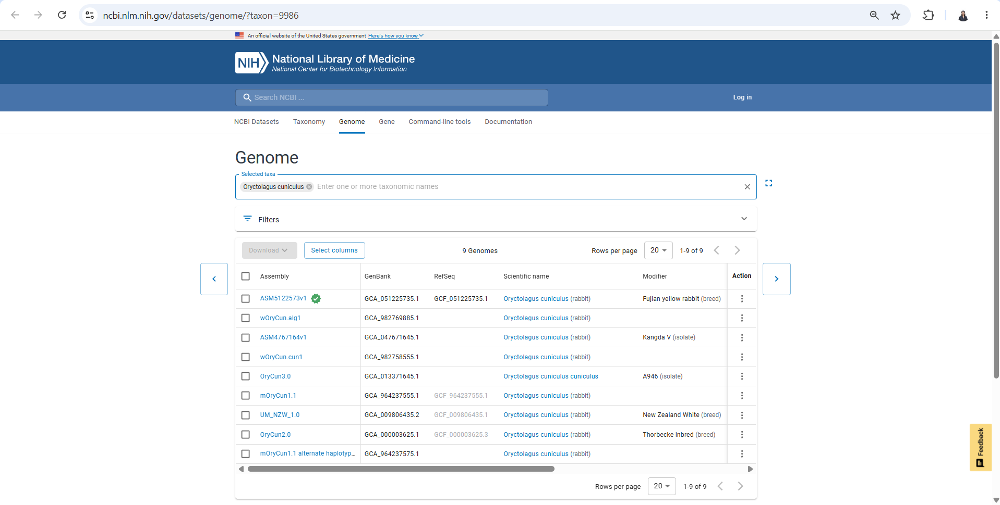
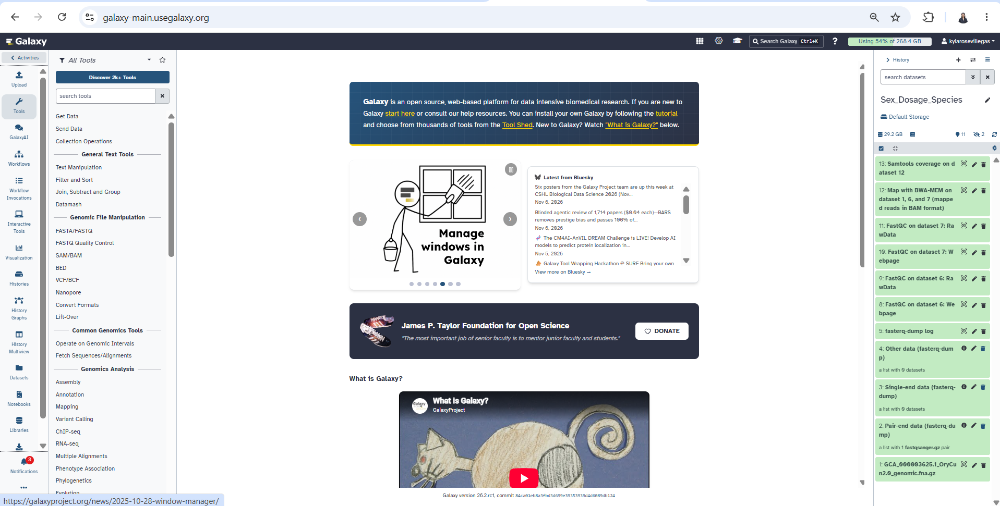
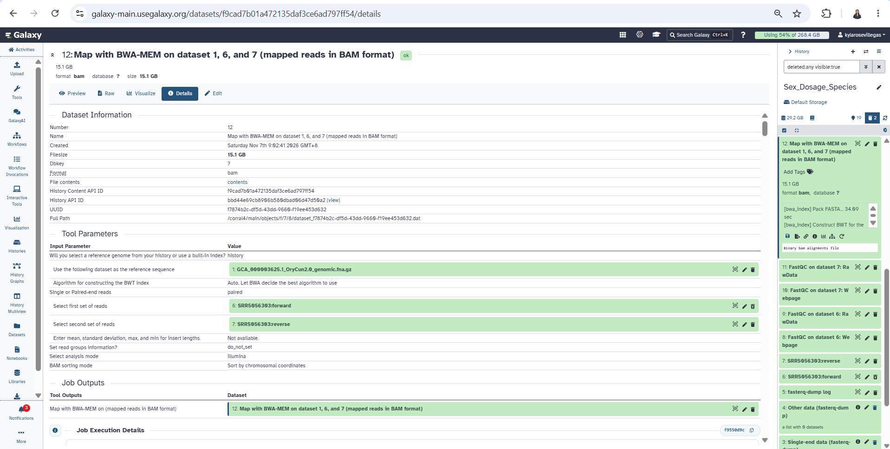
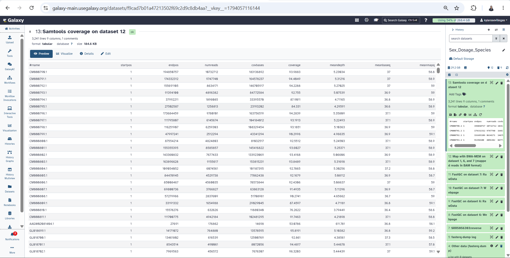
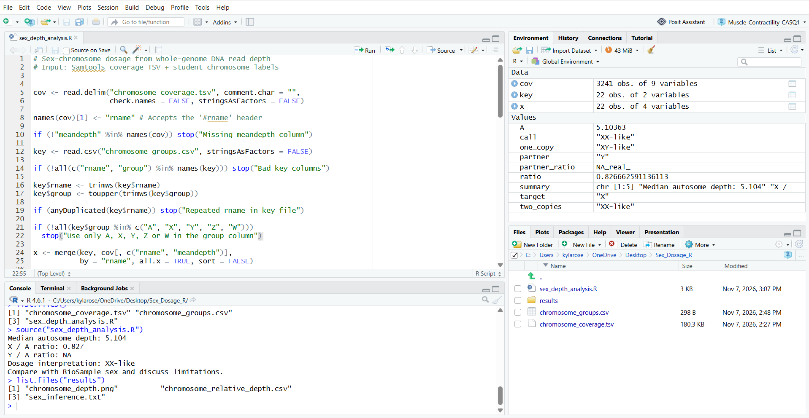

# CellMol Sex Chromosome Dosage Analysis – *Oryctolagus cuniculus*

## Student Information

**Name:** Kyla Rose D. Villegas  
**Section:** B  
**Course:** Cell and Molecular Biology  
**Practical Exercise:** Sex-Chromosome Dosage in a Selected Animal Nuclear Genome

---

# 1. Selected Species

**Scientific name:** *Oryctolagus cuniculus*  
**Common name:** European rabbit  
**Assembly:** OryCun2.0  
**Assembly accession:** GCA_000003625.1  
**Sex-chromosome system:** XX/XY

The selected species was *Oryctolagus cuniculus*. The OryCun2.0 assembly is a chromosome-level assembly containing chromosomes 1–21 and an X chromosome. This supports the use of an XX/XY sex-chromosome system for the analysis.

The assembly donor is recorded as female, but the assembly donor and the WGS donor used in this analysis are different individuals. Therefore, the sequence-based sex-chromosome dosage inference refers to the WGS donor only.

---

# 2. Study Question

Can whole-genome sequencing read depth mapped to the OryCun2.0 reference assembly be used to estimate X-chromosome dosage in *Oryctolagus cuniculus*?

The analysis compares the sequencing depth of the X chromosome with the median sequencing depth of the autosomes using the X:A ratio.

---

# 3. NCBI Accession Information

## Reference Assembly

**Assembly accession:** GCA_000003625.1  
**Assembly name:** OryCun2.0  
**Assembly BioSample:** SAMN02953624  
**Assembly donor sex:** Female

## WGS Dataset

**WGS run:** SRR5056303  
**WGS BioSample:** SAMN06054243  
**WGS donor sex:** Male  
**Library strategy:** WGS  
**Layout:** Paired-end

## Donor Comparison

The assembly donor and WGS donor were **not the same individual**.

Therefore, the X-chromosome dosage inference obtained from the WGS reads applies to the WGS donor and should not be interpreted as the sex of the assembly donor.

---

# 4. Study Data

### Reference genome

The following GenBank assembly was used:

```text
GCA_000003625.1_OryCun2.0_genomic.fna.gz
```

The corresponding assembly report was:

```text
GCA_000003625.1_OryCun2.0_assembly_report.txt
```

### WGS reads

The selected WGS run was:

```text
SRR5056303
```

The paired-end reads imported into Galaxy were:

```text
SRR5056303:forward
SRR5056303:reverse
```

---

# 5. Galaxy Analysis

## Galaxy History

**History name:**

```text
Sex_Dosage_Species
```

**Galaxy history/workflow link:**

```text
https://galaxy-main.usegalaxy.org/u/kylarosevillegas/h/sex-dosage-species 
```

---

## Step 1 – Download Reference Genome

The exact GenBank OryCun2.0 assembly was downloaded from NCBI.

The genomic FASTA file was:

```text
GCA_000003625.1_OryCun2.0_genomic.fna.gz
```

The assembly report was also downloaded:

```text
GCA_000003625.1_OryCun2.0_assembly_report.txt
```

The assembly report was used to verify chromosome identifiers.

---

## Step 2 – Create Galaxy History

A new Galaxy history was created with the name:

```text
Sex_Dosage_Species
```

The reference FASTA and WGS reads were imported into this history.

---

## Step 3 – Import WGS Reads

WGS run:

```text
SRR5056303
```

was imported using the Galaxy SRA FASTQ import tool.

The resulting paired-end datasets were:

```text
SRR5056303:forward
SRR5056303:reverse
```

Both reads were used as genomic DNA sequencing reads.

---

## Step 4 – FastQC

FastQC was performed separately on the forward and reverse reads.

The FastQC results showed acceptable sequence quality, including passing results for:

- Per-base sequence quality
- Per-sequence quality
- Adapter content
- Duplication-related quality assessment

No trimming was performed because the quality results did not require trimming for this analysis.

---

## Step 5 – BWA-MEM Alignment

The WGS reads were aligned to the same OryCun2.0 reference assembly using **BWA-MEM**.

The following settings were used:

- Reference genome: genome from Galaxy history
- Reference: `GCA_000003625.1_OryCun2.0_genomic.fna.gz`
- Reads: paired-end
- Forward reads: `SRR5056303:forward`
- Reverse reads: `SRR5056303:reverse`
- Analysis mode: Simple Illumina
- BAM sorting: Sort by chromosomal coordinates
- Read groups: Not set

The BWA-MEM analysis produced a coordinate-sorted BAM alignment.

---

## Step 6 – Samtools Coverage

The Galaxy tool **Samtools coverage** was used to calculate sequencing coverage for each reference sequence.

The following settings were used:

- Pool BAM files: No
- BAM input: BWA-MEM output
- Minimum mapping quality: 20
- Minimum base quality: 20
- Minimum read length: 0
- Histogram: No
- Required flags: None
- Excluded flags: default filtering for unmapped, non-primary, vendor QC-failed, and PCR/optical duplicate reads
- Output: Tabular

The resulting coverage table was downloaded as:

```text
chromosome_coverage.tsv
```

The table contained the required columns:

```text
rname
startpos
endpos
numreads
covbases
coverage
meandepth
meanbaseq
meanmapq
```

---

# 6. Chromosome Identification and Grouping

The chromosome identities were verified using the NCBI OryCun2.0 assembly report and the exact `rname` values present in the Samtools coverage output.

The chromosome-level sequences were divided into autosomes and the X chromosome.

## Autosomes

The following sequences were classified as autosomes:

```text
CM000790.1
CM000791.1
CM000792.1
CM000793.1
CM000794.1
CM000795.1
CM000796.1
CM000797.1
CM000798.1
CM000799.1
CM000800.1
CM000801.1
CM000802.1
CM000803.1
CM000804.1
CM000805.1
CM000806.1
CM000807.1
CM000808.1
CM000809.1
CM000810.1
```

These sequences correspond to chromosomes 1–21.

## X Chromosome

The X chromosome was:

```text
CM000811.1
```

The chromosome identifiers were copied exactly into `chromosome_groups.csv` so that they matched the coverage output.

Mitochondrial DNA, unplaced scaffolds, alternate haplotypes, and organelle sequences were not classified as autosomes.

---

# 7. Chromosome Groups File

The `chromosome_groups.csv` file contained:

```text
rname,group
CM000790.1,A
CM000791.1,A
CM000792.1,A
CM000793.1,A
CM000794.1,A
CM000795.1,A
CM000796.1,A
CM000797.1,A
CM000798.1,A
CM000799.1,A
CM000800.1,A
CM000801.1,A
CM000802.1,A
CM000803.1,A
CM000804.1,A
CM000805.1,A
CM000806.1,A
CM000807.1,A
CM000808.1,A
CM000809.1,A
CM000810.1,A
CM000811.1,X
```

The autosomes were grouped as `A`, while the single identified sex chromosome was grouped as `X`.

---

# 8. R Analysis

The analysis was performed using base R without additional packages.

The R script was saved as:

```text
sex_depth_analysis.R
```

The script calculated:

1. Median autosomal sequencing depth
2. Relative chromosome depth
3. X:A ratio
4. Sex-chromosome dosage interpretation
5. Chromosome-depth plot
6. Relative-depth CSV file
7. Sex-inference text file

The classroom interpretation guidelines were:

- X:A ≥ 0.80 → XX-like
- X:A ≤ 0.65 → XY-like
- 0.65 < X:A < 0.80 → Ambiguous

These are teaching guidelines and are not diagnostic thresholds.

---

# 9. Complete R Code

```r
# Sex-chromosome dosage from whole-genome DNA read depth
# Input: Samtools coverage TSV + student chromosome labels

cov <- read.delim("chromosome_coverage.tsv", comment.char = "",
                  check.names = FALSE, stringsAsFactors = FALSE)

names(cov)[1] <- "rname"

if (!"meandepth" %in% names(cov)) stop("Missing meandepth column")

key <- read.csv("chromosome_groups.csv", stringsAsFactors = FALSE)

if (!all(c("rname", "group") %in% names(key))) stop("Bad key columns")

key$rname <- trimws(key$rname)
key$group <- toupper(trimws(key$group))

if (anyDuplicated(key$rname)) stop("Repeated rname in key file")

if (!all(key$group %in% c("A", "X", "Y", "Z", "W")))
  stop("Use only A, X, Y, Z or W in the group column")

x <- merge(key, cov[, c("rname", "meandepth")],
           by = "rname", all.x = TRUE, sort = FALSE)

x$meandepth <- suppressWarnings(as.numeric(x$meandepth))

if (anyNA(x$meandepth)) stop("Missing depths: check rname matches")

if (any(x$meandepth < 0)) stop("Negative depth is not valid")

if (sum(x$group == "A") < 5) stop("Label at least 5 autosomes")

if ("X" %in% x$group && "Z" %in% x$group)
  stop("Choose either an XY or a ZW species, not both")

if (sum(x$group == "X") == 1 && !any(x$group == "Z")) {
  target <- "X"
  one_copy <- "XY-like"
  two_copies <- "XX-like"
} else if (sum(x$group == "Z") == 1 && !any(x$group == "X")) {
  target <- "Z"
  one_copy <- "ZW-like"
  two_copies <- "ZZ-like"
} else stop("Label exactly one X or exactly one Z chromosome")

A <- median(x$meandepth[x$group == "A"])

if (!is.finite(A) || A <= 0) stop("No usable autosomal coverage")

x$relative_depth <- x$meandepth / A

ratio <- x$relative_depth[x$group == target]

call <- if (ratio >= 0.80) two_copies else if (ratio <= 0.65)
  one_copy else "Ambiguous"

if (A < 1) call <- "Inconclusive: very low autosomal depth"

partner <- if (target == "X") "Y" else "W"

partner_ratio <- if (partner %in% x$group)
  x$relative_depth[x$group == partner][1] else NA_real_

dir.create("results", showWarnings = FALSE)

write.csv(x, "results/chromosome_relative_depth.csv", row.names = FALSE)

png("results/chromosome_depth.png", width = 1000, height = 580)

par(mar = c(8, 4, 3, 1))

barplot(x$relative_depth, names.arg = x$rname, las = 2,
        ylab = "Depth relative to median autosome",
        main = "Autosomal and sex-chromosome depth", cex.names = 0.75)

abline(h = c(0.5, 1.0), lty = 2)

dev.off()

summary <- c(paste("Median autosome depth:", round(A, 3)),
             paste(target, "/ A ratio:", round(ratio, 3)),
             paste(partner, "/ A ratio:", round(partner_ratio, 3)),
             paste("Dosage interpretation:", call),
             "Compare with BioSample sex and discuss limitations.")

writeLines(summary, "results/sex_inference.txt")

cat(paste(summary, collapse = "\n"), "\n")
```

---

# 10. Results

## Median Autosomal Depth

```text
5.104×
```

## X Chromosome Mean Depth

```text
4.21898×
```

## X:A Ratio

```text
0.827
```

More precisely:

```text
0.82666
```

## Y:A Ratio

```text
NA
```

The selected reference assembly does not contain an annotated Y chromosome, so a Y:A ratio could not be calculated.

## Dosage Interpretation

```text
XX-like
```

The X:A ratio of 0.827 is above the classroom threshold of 0.80 and is closer to the expected X:A ratio of approximately 1.0 for an XX complement than approximately 0.5 for an XY complement.

---

# 11. Relative Chromosome Depth Results

The calculated relative depths were:

| Chromosome | Group | Mean Depth | Relative Depth |
|---|---|---:|---:|
| CM000790.1 | A | 5.23034 | 1.02483 |
| CM000791.1 | A | 5.31216 | 1.04086 |
| CM000792.1 | A | 5.27025 | 1.03265 |
| CM000793.1 | A | 5.07539 | 0.99447 |
| CM000794.1 | A | 4.71165 | 0.92320 |
| CM000795.1 | A | 4.29591 | 0.84174 |
| CM000796.1 | A | 5.35809 | 1.04986 |
| CM000797.1 | A | 5.22493 | 1.02377 |
| CM000798.1 | A | 5.10363 | 1.00000 |
| CM000799.1 | A | 4.96635 | 0.97310 |
| CM000800.1 | A | 5.24503 | 1.02771 |
| CM000801.1 | A | 5.25371 | 1.02941 |
| CM000802.1 | A | 5.06606 | 0.99264 |
| CM000803.1 | A | 5.31698 | 1.04180 |
| CM000804.1 | A | 5.30256 | 1.03898 |
| CM000805.1 | A | 5.08112 | 0.99559 |
| CM000806.1 | A | 5.08637 | 0.99662 |
| CM000807.1 | A | 5.11296 | 1.00183 |
| CM000808.1 | A | 4.65662 | 0.91241 |
| CM000809.1 | A | 4.71181 | 0.92323 |
| CM000810.1 | A | 3.79449 | 0.74349 |
| CM000811.1 | X | 4.21898 | 0.82666 |

The autosomal chromosomes generally showed relative depths near 1.0, while the X chromosome showed a relative depth of approximately 0.827.

---

# 12. Output Files

The analysis produced the following files:

```text
results/
├── chromosome_relative_depth.csv
├── chromosome_depth.png
└── sex_inference.txt
```

The input coverage file was:

```text
data/
└── chromosome_coverage.tsv
```

The chromosome grouping file was:

```text
chromosome_groups.csv
```

The R analysis script was:

```text
code/
└── sex_depth_analysis.R
```

---

# 13. Questions for the Report

## Question 1

### What species did you choose, and what evidence supports a diploid XX/XY or ZZ/ZW system?

The selected species was *Oryctolagus cuniculus* (European rabbit). The species has a diploid XX/XY sex-chromosome system. The OryCun2.0 assembly contains chromosomes 1–21 and an annotated X chromosome, supporting the use of an X-based sex-chromosome system.

---

## Question 2

### What are your assembly accession, WGS run, and both BioSample accessions? Are the donors the same?

The assembly accession was **GCA_000003625.1 (OryCun2.0)**, with assembly BioSample **SAMN02953624**.

The WGS run was **SRR5056303**, with WGS BioSample **SAMN06054243**.

The donors were **not the same individual**. Therefore, the chromosome-dosage inference applies to the WGS donor and should not be directly compared with the assembly donor's sex.

---

## Question 3

### Which sequences were used as autosomes and as X or Z? How did you verify their identities?

The autosomes used were **CM000790.1 through CM000810.1**, representing chromosomes 1–21.

The X chromosome was **CM000811.1**.

Their identities were verified using the NCBI OryCun2.0 assembly report and by confirming that the chromosome identifiers exactly matched the `rname` values in the Samtools coverage output.

Mitochondrial DNA, unplaced scaffolds, alternate haplotypes, and other non-chromosomal sequences were not classified as autosomes.

---

## Question 4

### What are the median autosomal depth, X:A or Z:A ratio, and inferred sex-chromosome complement?

The median autosomal sequencing depth was **5.104×**.

The X:A ratio was **0.827**.

The inferred sex-chromosome complement was **XX-like** according to the classroom analysis guidelines.

---

## Question 5

### Does your result agree with the recorded sex of the WGS donor, if reported? Explain any discrepancy or uncertainty.

No. The WGS BioSample is recorded as **male**, whereas the read-depth analysis produced an **XX-like** X:A ratio of 0.827.

This discrepancy may be related to technical factors such as mapping bias, sequencing-depth variation, repetitive sequences, pseudoautosomal regions, reference-related limitations, or other genomic factors.

The selected reference assembly does not contain an annotated Y chromosome, so a Y:A ratio could not be calculated. Therefore, the lack of a Y:A value does not by itself prove the absence of a Y chromosome.

The classroom cutoff is a teaching guideline rather than a diagnostic threshold.

---

## Question 6

### Why is a chromosome-level assembly alone insufficient for a reliable read-depth sex inference?

A chromosome-level assembly provides the reference sequences and chromosome identities, but it does not measure sequencing depth from the actual WGS donor.

Reliable sex-chromosome dosage inference requires WGS reads to be mapped to the reference and the sex-chromosome depth to be compared with autosomal depth.

Factors such as low read depth, mapping bias, repetitive sequences, pseudoautosomal regions, reference errors, missing Y/W sequences, and unusual karyotypes can distort the ratio.

Therefore, chromosome lengths or the assembly FASTA alone cannot be used to infer sex-chromosome dosage.

---

# 14. Interpretation

The X:A ratio of 0.827 indicates an XX-like chromosome dosage under the classroom analysis guidelines. In an ordinary diploid XX/XY system, an XX individual is expected to have an X:A ratio near 1.0, whereas an XY individual is expected to have a ratio near 0.5.

The observed value is therefore more consistent with two X copies than one X copy.

However, the WGS BioSample is reported as male. This creates a discordance between the sequence-based inference and the recorded metadata.

The discrepancy should not be ignored or artificially corrected. The sequence result should be reported as an **XX-like read-depth inference**, while the metadata should be reported separately as male.

---

# 15. Limitations

Several limitations may affect the reliability of the inferred chromosome dosage.

1. The median autosomal depth was only 5.104×.
2. Low sequencing depth can increase sampling variation.
3. Mapping bias may affect the relative coverage of the X chromosome.
4. Repetitive genomic regions may produce ambiguous or incorrect read alignments.
5. Pseudoautosomal regions can have different coverage behavior.
6. The selected assembly does not contain an annotated Y chromosome.
7. The absence of a Y:A measurement does not prove that a Y chromosome is absent.
8. The assembly donor and WGS donor were different individuals.
9. The WGS BioSample metadata reports the donor as male.
10. The classroom thresholds are teaching guidelines rather than diagnostic thresholds.
11. Reference genome errors or incomplete sex-chromosome representation can affect read mapping.
12. Unusual karyotypes could produce atypical chromosome-depth ratios.

Therefore, the result should be interpreted as an **XX-like dosage inference from sequencing read depth**, not as definitive biological sex determination.

---

# 16. Screenshots

The following screenshots should be uploaded to the `screenshots/` folder.

## Screenshot 1 – NCBI Assembly

```text
screenshots/01_NCBI_assembly.png
```

This screenshot should show the selected OryCun2.0 assembly and accession.



---

## Screenshot 2 – Galaxy History

```text
screenshots/02_Galaxy_history.png
```

This screenshot should show the Galaxy history named `Sex_Dosage_Species`.



---

## Screenshot 3 – FastQC

```text
screenshots/03_FastQC.png
```

This screenshot should show the FastQC results for the WGS reads.


---

## Screenshot 4 – BWA-MEM

```text
screenshots/04_BWA_MEM.png
```

This screenshot should show the BWA-MEM settings or completed alignment output.



---

## Screenshot 5 – Samtools Coverage

```text
screenshots/05_Samtools_coverage.png
```

This screenshot should show the Samtools coverage settings or completed coverage output.



---

## Screenshot 6 – R Analysis Results

```text
screenshots/06_R_results.png
```

This screenshot should show the R console output containing:

```text
Median autosome depth: 5.104
X / A ratio: 0.827
Y / A ratio: NA
Dosage interpretation: XX-like
```



---

# 17. Repository Structure

The final GitHub repository should contain:

```text
CellMol_SexChrom_Oryctolagus_cuniculus/
│
├── README.md
│
├── chromosome_groups.csv
│
├── data/
│   └── chromosome_coverage.tsv
│
├── code/
│   └── sex_depth_analysis.R
│
├── results/
│   ├── chromosome_relative_depth.csv
│   ├── chromosome_depth.png
│   └── sex_inference.txt
│
└── screenshots/
    ├── 01_NCBI_assembly.png
    ├── 02_Galaxy_history.png
    ├── 03_FastQC.png
    ├── 04_BWA_MEM.png
    ├── 05_Samtools_coverage.png
    └── 06_R_results.png
```

---

# 18. Files Not Uploaded

Large sequencing and genome files were intentionally excluded from the GitHub repository.

The following files should **NOT** be uploaded:

```text
FASTQ files
FASTA files
BAM files
CRAM files
```

Only the required smaller analysis outputs, code, coverage table, chromosome grouping file, figure, results, screenshots, and documentation should be included.

---

# 19. Conclusion

Whole-genome sequencing read depth was used to estimate X-chromosome dosage in *Oryctolagus cuniculus*. The median autosomal sequencing depth was 5.104× and the X:A ratio was 0.827. This produced an XX-like dosage inference according to the classroom analysis guidelines.

However, the WGS BioSample is recorded as male. Therefore, the sequence-based inference does not agree with the recorded WGS donor sex. Because the assembly and WGS donors were different individuals, the inference applies only to the WGS donor.

The absence of an annotated Y chromosome in the selected reference prevents calculation of a Y:A ratio. Consequently, the result should be interpreted cautiously as an XX-like read-depth inference rather than definitive evidence of biological sex.

---

# 20. References

### NCBI Assembly

*Oryctolagus cuniculus* OryCun2.0 genome assembly.

**Assembly accession:** GCA_000003625.1

### NCBI BioSample

**Assembly BioSample:** SAMN02953624

**WGS BioSample:** SAMN06054243

### NCBI SRA

**WGS run:** SRR5056303

### Galaxy

Galaxy Project. UseGalaxy.org.

### SAMtools

SAMtools `coverage` documentation.

### Laboratory Manual

Cell and Molecular Biology – Individual Practical Exercise: Sex-Chromosome Dosage in a Selected Animal Nuclear Genome.

---
